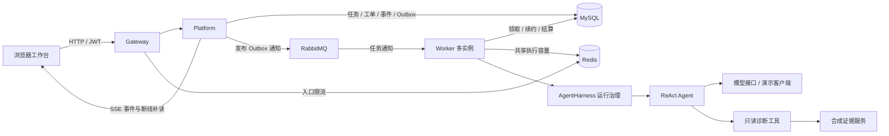

# IncidentHarness｜故障诊断与工单平台

面向故障调查的 **Agent Harness**，将工具授权、执行预算、取消控制、事件记录和报告验收组织为统一运行链路，支持异步诊断、证据引用与人工复核。

项目面向内部技术支持场景：用户提交“任务持续排队”等问题，系统在指定服务、环境和时间窗口内读取健康状态、指标、日志与运维手册，生成带证据引用的调查报告，由用户确认或转交处理。

故障诊断与通用任务通过同一个 Harness 执行入口接入。底层复用 Spring Boot、MySQL、Redis 和 RabbitMQ，处理重复提交、消息重投、Worker 失联和客户端断线等后端问题。

## 业务流程

```text
提交故障工单 → 校验调查范围 → 异步调度 → 读取现场证据 → 生成调查报告 → 人工确认或转交
```

以“任务持续排队”为例，调查可读取组件健康状态、队列与容量指标、相关日志和运维手册，再把观察结果及其引用写入报告。信息不足时，报告返回待补充项，供人工继续调查。

- **故障调查**：提供健康、指标、日志、手册四类只读工具，限定资源、时间窗口、调用次数和响应体积。
- **任务工作台**：支持注册登录、异步提交、执行步骤与实时耗时展示、断线恢复、历史事件回放和取消请求。
- **人工复核**：报告与工单处理状态分别保存，支持确认、转交及操作留痕；建议以文本呈现，不自动执行修复。
- **知识查询**：通用任务只可绑定自己的知识文档，Worker 在工具实例和 SQL 查询中限定用户与文档范围。

用户隔离同时落在认证、服务端查询和工具实例上：JWT 必须包含有效身份与过期时间，任务查询和用户写操作在 SQL 中限定所有者，知识工具不能通过模型参数切换用户或文档。任务 API 使用响应字段白名单，隐藏 Worker 地址、租约和内部执行配置；浏览器入口限制同源脚本与连接。详见[数据安全与用户隔离](docs/08-data-isolation.md)，其中也说明了当前用户级隔离与组织级多租户的边界。

当前诊断场景使用独立的**合成证据源**，覆盖消费者缺失、消息连接失败、执行容量已满和信息不足四类演示环境。无需模型密钥即可体验业务流程；接入真实模型后，仍在同一受控环境中调查。

## 系统架构



平台负责认证、工单管理和任务调度，Worker 独立执行耗时的模型与工具调用。MySQL 保存任务状态、执行权、事件和结算记录，RabbitMQ 负责异步通知，Redis 协调入口限流与跨 Worker 执行容量。

当前采用共享数据库的多进程架构，Worker 支持多实例部署。

## Harness 如何运行

1. **建立执行上下文**：Worker 从任务快照创建 `HarnessContext`，绑定任务、追踪标识和执行尝试编号。
2. **装配业务策略**：`DiagnosisWorkflow` 提供诊断工具白名单、十二次调用预算、调查指令和报告验收；`SafeTaskWorkflow` 保留计算及知识查询等通用任务。
3. **统一执行门禁**：`AgentHarness` 过滤模型可见的工具，并在实际调用入口检查授权、预算、取消和截止时间。未知工具和参数错误同样消耗调用预算，工具等待受剩余执行时间约束。
4. **验收正式结果**：模型循环完成后调用业务 `accept`；报告引用或格式不合规时不发布正式答案，已知模型用量仍保留。
5. **记录并结算**：Worker 持久化 `harness` 阶段事件与实际调用次数，随后按原有租约与幂等事务完成结算和消息确认。

执行过程中按实际顺序展示模型分析、工具调用及结果验收，每步标明运行、重试、完成或中断状态。工具自动重试更新同一步骤；页面刷新后先读取有权限校验的进度快照，再按事件序号合并 SSE 更新。步骤动态产生，页面展示实际耗时和已完成数量；不预估完成百分比或剩余时间。详见 [执行步骤与进度恢复](docs/07-harness.md#执行步骤与进度恢复)。

工具错误使用结构化分类：参数错误交给后续模型决策纠正；只对服务端声明安全的读取，在瞬时故障时自动重试一次，且每次重试都消耗原有预算。权限拒绝、超时、资源不足等硬性错误直接停止。`tool_attempt` 与 `tool_retry` 记录实际尝试和恢复过程，失败提示不回显原始参数或底层异常消息。详见 [工具故障分类与恢复](docs/07-harness.md#工具故障分类与恢复)。

运行治理位于 [`agent-core` 的 `harness` 包](agent-core/src/main/java/com/agent4/harness)，不依赖 Spring、数据库或 MQ。业务通过 `HarnessWorkflow` 扩展，工具通过 `ToolExecutor` 接入，ReAct 继续负责模型与工具交互循环。流式增量属于过程数据，正式结果事件在验收后发出。

执行中新增有界工作记忆：早期工具观察即使被裁出消息窗口，也可通过索引引用调用 `recall_memory` 读回；召回不重复访问源工具，并受同一调用预算、取消和时间约束。工作记忆按任务与执行尝试保存快照，所有者可查询版本及索引元数据。详见[工作记忆与执行状态](docs/10-working-memory-and-state.md)。

失联恢复仍从持久化输入开始新的执行尝试，各次记忆和证据分别保存；自动跨 Worker 断点续跑尚未实现。运行层阻止到期后的新工作与正式结果发布，阻塞调用由工具超时和 Worker 心跳尽力中断。详细接口和边界见 [Harness 设计与接入指南](docs/07-harness.md)。

## 核心设计

| 需要解决的问题 | 实现方式 | 源码入口 |
|---|---|---|
| 创建任务成功，但发送 MQ 失败 | 任务、额度预留、初始事件和 Outbox 同事务落库；事务外发布并检查 RabbitMQ 确认与退回 | [TaskStore](backend-common/src/main/java/com/agent4/backend/TaskStore.java)、[DispatchPublisher](backend-common/src/main/java/com/agent4/backend/DispatchPublisher.java) |
| 用户重复提交或消息重复投递 | 用户与幂等键唯一约束、输入一致性检查、数据库条件领取，以及唯一结算账本 | [任务表与约束](backend-common/src/main/resources/db/migration/V1__platform.sql)、[TaskConsumer](worker-service/src/main/java/com/agent4/worker/TaskConsumer.java) |
| Worker 失联后恢复，旧执行者迟到写回 | 数据库租约、心跳和递增 `attemptNo` 共同校验执行权，拒绝过期执行者修改结果；失联任务有限重试 | [TaskStore](backend-common/src/main/java/com/agent4/backend/TaskStore.java) |
| 多 Worker 同时争抢容量、等待任务集中重试 | Redis Lua 管理用户/全局槽位，按用户与 token 释放；容量等待采用有界抖动退避，状态、事件和 Outbox 同事务提交 | [RedisSlots](backend-common/src/main/java/com/agent4/backend/RedisSlots.java)、[调度说明](docs/09-scheduling-and-capacity.md) |
| 断线后丢失任务进度，或跨用户读取结果 | 事件持久化并按 `Last-Event-ID` 补读；网关与平台独立校验 JWT，资源查询校验所有者 | [TaskStreamController](platform-service/src/main/java/com/agent4/platform/api/TaskStreamController.java)、[平台 API](platform-service/src/main/java/com/agent4/platform/api) |
| Agent 扩大调查范围或编造证据引用 | 固定资源目录、只读工具、参数与预算校验；生成报告后校验结构及本次执行的证据引用 | [DiagnosisPolicy](common-contract/src/main/java/com/agent4/contract/DiagnosisPolicy.java)、[DiagnosisWorkflow](worker-service/src/main/java/com/agent4/worker/diagnosis/DiagnosisWorkflow.java) |

Workflow 负责定义调查权限、预算和报告契约；接入真实模型时，Agent 在这些边界内选择工具和调整调查过程。无密钥模式使用规则演示客户端，便于复现业务链路。

详细设计与权衡见[架构与选型记录](docs/02-architecture-and-decisions.md)。

## 技术栈与模块

| 层次 | 技术与用途 |
|---|---|
| 后端与入口 | Java 17、Spring Boot 3.2.5、Spring Cloud Gateway、Spring Security、JWT |
| 数据与迁移 | MySQL、Spring JDBC、Flyway；保存业务状态、事件和事务记录 |
| 异步与协调 | RabbitMQ、Spring AMQP、Redis Lua；任务通知、限流与共享容量 |
| Agent 执行 | ReAct、工具调用、OpenAI 兼容模型接口、受控只读诊断工具 |
| 交互与部署 | 原生 JavaScript、fetch/SSE、Docker Compose |
| 测试与自动检查 | JUnit 5、Mockito、H2、Testcontainers、GitHub Actions |

| 模块 | 职责 |
|---|---|
| `agent-core` | Harness 运行治理、ReAct 循环、模型协议、工具执行接口与记忆窗口 |
| `common-contract` | 任务、事件、执行配置、诊断范围和跨服务协议 |
| `backend-common` | 事务仓储、Outbox、租约状态机、额度结算与 Redis 槽位 |
| `platform-service` | 注册登录、任务与工单 API、知识管理、SSE 和恢复调度 |
| `worker-service` | 消费通知、租约续约、业务适配器装配、Harness 接入与事务结算 |
| `gateway-service` | 统一路由、JWT 校验与共享入口限流 |
| `legacy-demo` | SQLite 单机版本，保留用于对照架构演进 |

## 本地运行

### 1. 启动演示环境

准备 Java 17、Maven 和可用的 Docker Compose，在项目根目录执行：

```powershell
mvn -B -ntp clean package
docker compose up -d --build
```

打开 <http://localhost:18080>，注册并登录后，在故障工单区域选择演示环境、调查时间和问题描述，提交后查看执行事件与报告，再进行人工确认或转交。

默认不需要模型密钥，报告标记为 `DEMO_SCRIPT`。演示环境与工单字段说明见[故障诊断运行指南](docs/06-diagnosis-workflow.md)。

### 2. 可选：接入真实模型

以当前配置的 DeepSeek 接口为例，在启动 Compose 的 PowerShell 中设置环境变量后重新创建 Worker：

```powershell
$env:DEEPSEEK_API_KEY = '替换为你的模型密钥'
docker compose up -d --force-recreate worker
```

真实模型模式标记为 `REAL_MODEL`；密钥只在本地配置，不写入源码。当前两种模式都使用合成证据源，适合受控演示与后续模型评估。

### 3. 验证业务链路与多 Worker

在未配置真实模型密钥的演示环境中，可运行四个诊断场景的验收脚本：

```powershell
node scripts/diagnosis-smoke.mjs
```

需要观察多 Worker 竞争领取和共享容量时，执行：

```powershell
docker compose up -d --scale worker=2
```

默认本机入口为 `18080`，平台调试端口为 `8081`，合成证据服务为 `18091`；数据库与消息组件端口及配置见 [compose.yml](compose.yml)。

## 测试与验证

| 验证层次 | 命令 | 覆盖范围 |
|---|---|---|
| 默认构建与回归 | `mvn -B -ntp verify` | 全模块构建，Agent、事务、API、Worker、网关及旧版回归 |
| 真实中间件集成 | `mvn -B -ntp verify -Pintegration` | Docker 中的 MySQL、Redis、RabbitMQ；需要可用的 Docker 引擎 |
| 诊断业务验收 | `node scripts/diagnosis-smoke.mjs` | Compose 演示环境中的四场景、幂等提交、资源隔离与人工处理 |
| 前端语法 | `node --check platform-service/src/main/resources/static/app.js` | 浏览器应用的 JavaScript 语法 |
| 进度状态回归 | `node --test scripts/progress.test.cjs` | 快照恢复、事件去重、重试、取消、中断和计时 |
| 进度浏览器验证 | `node scripts/progress-ui-smoke.mjs` | 本地固定 API/SSE 下的实际页面交互，环境准备见测试指南 |
| 真实模型评估 | `node scripts/evaluate.mjs` | 固定任务集评估；需配置真实模型，拒绝对演示响应评分 |

**最近一次本地默认回归（2026-11-21）**：全模块构建成功，23 个测试套件、152 项默认测试通过，失败、错误、跳过均为 0；新增 15 项工作记忆与状态回归，覆盖四消息窗口中的早期观察裁剪/召回、预算与取消、实例及尝试隔离、快照校验、幂等与拒绝回退、失权拒绝、事务回滚和接口元数据保护。8 项前端状态测试通过。本次未运行完整 Docker/MySQL/RabbitMQ 集成、Redis 集成、浏览器交互或真实模型评估，详见[维护日志](docs/maintenance-log.md)。

[GitHub Actions 工作流](.github/workflows/ci.yml) 已配置推送、PR 和手动触发，自动执行 Java 构建、默认回归和 JavaScript 语法检查。每次云端结果以 Actions 中对应的运行记录为准，测试报告保留七天。

历史中间件集成、并发幂等与 Worker 恢复实验见[实际验证记录](docs/05-verification.md)；测试分层和压测方法见[测试指南](docs/04-testing-and-benchmarks.md)。

## 文档导航

- [模块阅读指南](docs/01-module-guide.md)：从一次请求理解代码调用链。
- [架构与选型记录](docs/02-architecture-and-decisions.md)：事务边界、状态流转与技术权衡。
- [API 与运行说明](docs/03-api-and-operations.md)：接口、配置与排查方式。
- [故障诊断指南](docs/06-diagnosis-workflow.md)：工具授权、调查预算、报告验收与业务 API。
- [Harness 设计与接入指南](docs/07-harness.md)：运行契约、治理边界和业务扩展方式。
- [数据安全与用户隔离](docs/08-data-isolation.md)：身份校验、数据访问范围、响应字段白名单及安全验证边界。
- [并发调度与资源控制](docs/09-scheduling-and-capacity.md)：准入上限、可靠容量退避、槽位归属和并发测试。
- [工作记忆与执行状态](docs/10-working-memory-and-state.md)：观察索引、按引用召回、快照持久化与恢复边界。
- [测试与评估](docs/04-testing-and-benchmarks.md) · [历史验证记录](docs/05-verification.md) · [维护日志](docs/maintenance-log.md)。

## 当前范围与后续方向

- **场景接入**：当前使用合成证据；下一步接入真实系统的只读观测接口，补齐资源级授权和数据脱敏。
- **报告质量**：现有验收校验结构与引用存在性，结论由人工复核；后续建立真实模型固定评估集，检查证据支持度、信息不足时的应答、用量与时延。
- **服务部署**：当前支持多 Worker，平台与 Worker 共享数据库；后续结合压测结果评估平台多实例路由与事件读取成本。

当前仓库用于本地复现和工程实践。容量指标、模型诊断效果及公开部署条件分别验证；现有记录未提供生产吞吐或诊断准确率结论。
