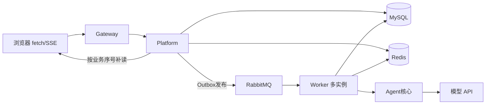
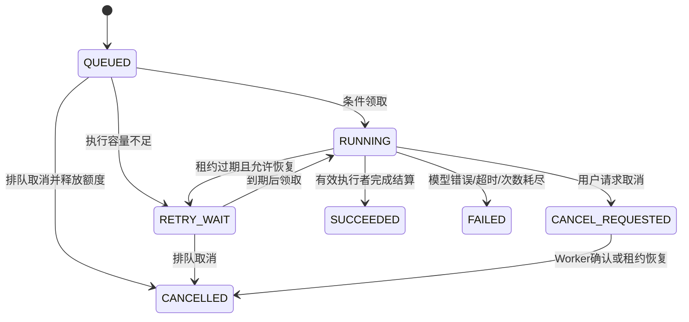

# 架构与选型依据

## 需求与边界

目标是本地可复现、多用户、可运行多个 Worker 的 AI 任务平台。验证突发提交、异步执行、任务幂等和故障恢复。没有真实业务流量支撑，不宣称生产级规模或特定 QPS。

## 决策记录

| 决策 | 选择理由 | 放弃方案与代价 |
|---|---|---|
| Java 17 + Spring Boot | 沿用已有引擎，重点展示事务、认证、并发和消息工程能力 | 不因为 AI 场景就重写 FastAPI；当前没有必须使用 Python 的模型训练需求 |
| 手写单 Agent | 工作流是有限轮模型与工具交互，可直接控制协议和取消边界 | 自己承担兼容性测试；没有对比实验证明优于 LangChain/LangGraph，也不引入多 Agent 协作开销 |
| MySQL + JDBC | 核心难点是状态条件更新、行锁与多表事务，显式 SQL 更容易审查 | 比 ORM 多写映射代码；当前没有证据需要分库分表 |
| RabbitMQ | 提交与耗时执行解耦，允许独立 Worker 和消息确认 | 增加 Outbox、重复消费、死信与运维成本；数据库任务队列也可满足较小规模，但本项目选择验证消息系统协作 |
| Redis Lua + 有序集合 | 多实例共同限制用户与供应商执行容量，按成员过期 | Redis 故障时保守拒绝/停止；容量许可不代表第三方已经中止旧网络调用 |
| 数据库租约 + attemptNo | 任务状态、事件与执行权处于一个事务域，可拒绝旧结果写回 | 不依赖一把可过期 Redis 锁；外部副作用仍需自己的幂等机制 |
| 事务 Outbox | 任务和待发送通知原子落库，发送期间不占用业务事务 | 至少一次通知会重复，不能声称 exactly-once |
| JWT 双端验签 | 网关过滤无效流量，平台独立验证真实身份 | 默认 HS256 适合单一信任域，网关也持有签名能力；更大信任边界可迁移非对称密钥 |
| fetch 读取 SSE | 可携带 Authorization 和 Last-Event-ID，与当前前端兼容 | 自行实现解析、退避与重连；暂不增加一次性票据系统 |
| 数据库事件补读 | 事件真相与任务状态一致，不引入双写与 Stream ID 对齐 | 有轮询读压力、连接发送容量有限；压测后再决定是否加实时事件总线 |
| 本地特征哈希检索 | 离线可运行，复用已有实现，单文档范围可控 | 不是语义 embedding；同义词和复杂语义效果有限，需要评估后再替换 |

## 关键事务边界

**提交事务**：锁用户 → 检查请求幂等和文档权限 → 固定 UTC 账期与执行配置 → 检查/预留额度 → 创建任务 → 写 queued 事件 → 写 Outbox。

**领取事务**：锁任务 → 校验排队/退避状态与时间 → 递增 attemptNo → 绑定 workerId 和租约 → 创建 attempt → 写 running 事件。

**完成事务**：锁任务 → 补报该尝试已知用量 → 验证当前执行权 → 确定最终状态 → 写唯一任务结算账本 → 更新原账期额度 → 写终态与 done 事件。任一步失败整体回滚。

重复完成不会二次结算。旧尝试可以按 taskId/attemptNo/workerId 补报已知用量，但无权更改任务终态或重新扣减次数。

## 状态流转

模型请求错误第一版直接结束任务；仅租约失联触发最多三次执行尝试。容量不足的退避不消耗 attemptNo。无法自动恢复外部写操作，因此新平台不开放任意网页抓取、写笔记、发消息等工具。

## 分布式限制必须诚实表达

- fencing 保护本系统数据库写入，不撤销外部副作用。停止后会尽力断开网络，但供应商可能已产生费用。
- Redis 许可过期和失联 Worker 的网络请求可能暂时重叠，严格供应商并发上限还需要供应商侧限制或单独出口控制。
- 平台和 Worker 共享数据库，方便展示本地事务与跨进程协作；不能描述为独立数据库微服务。
- 网关使用一个平台服务地址，当前没有实现多个平台实例的负载均衡。Worker 可直接水平扩展。
- 固定窗口限流在窗口边界可能产生瞬时突发；当前没有实现严格公平队列或全局先进先出。
- Compose 和依赖沿用固定开发基线，公开部署前仍需要依赖安全检查、密钥管理、TLS、备份和容量评估。

## 实现时查阅的官方资料

- [Spring AMQP：发布确认与退回](https://docs.spring.io/spring-amqp/reference/amqp/template.html)
- [Spring：事务边界与代理行为](https://docs.spring.io/spring-framework/reference/data-access/transaction/declarative/annotations.html)
- [Spring Data Redis：Lua 脚本执行](https://docs.spring.io/spring-data/redis/reference/redis/scripting.html)

版本行为以实际依赖和集成测试为准，参考站点默认页可能展示更新的大版本。
