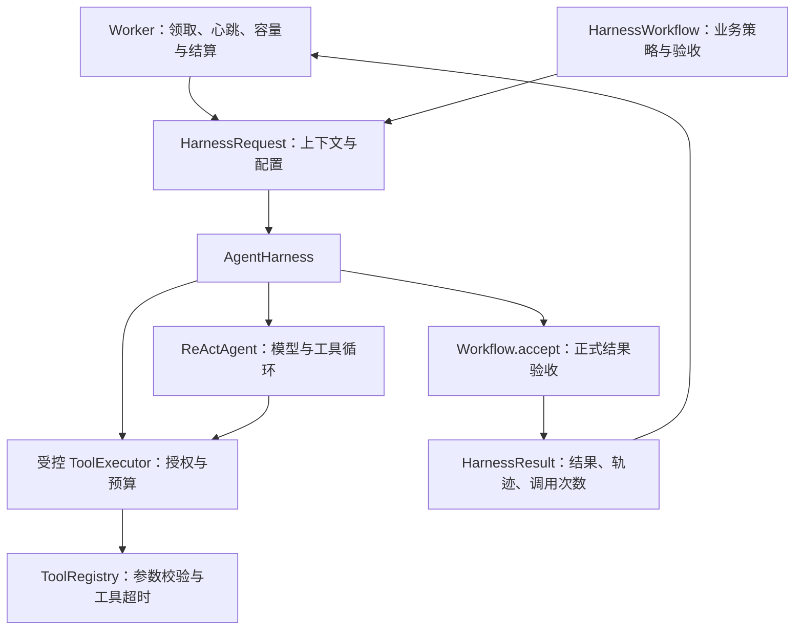

# IncidentHarness：运行契约与业务接入

IncidentHarness 将故障调查中的通用运行治理从 Worker 业务分支中提取出来。平台仍以故障诊断与工单为主线，诊断和通用任务通过同一执行入口运行。

## 职责划分



| 契约 | 作用 |
|---|---|
| `HarnessContext` | 固定 `taskId`、`traceId`、`attemptNo`，用于关联一次持久化执行尝试 |
| `HarnessPolicy` | 固定版本、授权工具集合、工具次数上限、执行阶段时限；工具集合做防御性复制 |
| `HarnessWorkflow` | 提供策略、可选系统指令以及业务 `accept` 验收 |
| `HarnessRequest` | 聚合身份、任务目标、既有 `AgentConfig` 与业务适配器，并校验配置 |
| `ToolExecutor` | 工具声明、名称与带超时的调用能力；注册表和 Harness 门禁共用该接口 |
| `HarnessResult` | 正式结果、失败原因、原始循环轨迹和实际消耗的工具调用次数 |

代码入口为 [`AgentHarness`](../agent-core/src/main/java/com/agent4/harness/AgentHarness.java)。运行层不引用 Spring、JDBC、Redis 或 RabbitMQ；这些设施由 Worker 和既有后端模块负责。

## 执行与治理

1. 每次 `run` 创建独立的 ReAct 实例、记忆窗口、调用计数和截止时间，同一个 Harness 不共享运行状态。
2. 业务白名单必须是注册表现有工具的子集。下发给模型的声明过滤为该白名单，实际调用时再检查一次授权。
3. 先检查调用预算，再判断工具授权和参数。未知工具、未授权工具、坏参数都消耗一次预算；超过上限时终止执行，超额请求不执行。
4. 工具等待上限取 `AgentConfig.toolTimeoutMs` 与剩余执行时间的较小值。模型轮次、文本增量、工具调用、观察和最终结果阶段均检查停止信号与截止时间。
5. ReAct 循环完成后调用 `workflow.accept`。验收拒绝时返回失败且正式答案为空；只有验收成功后才发出 `onFinalAnswer`。
6. 原始轨迹仍保留已知模型用量。轨迹的 `COMPLETED` 只表示模型循环完成，业务成功必须查看 `HarnessResult.successful()`。

流式 `onAssistantDelta` 是尚未验收的过程数据，不等同于正式答案。诊断适配器沿用不展示未验收报告增量的策略。

## 两个业务适配器

| 适配器 | 工具与预算 | 结果验收 |
|---|---|---|
| `DiagnosisWorkflow` | 四类只读诊断工具，每次尝试最多十二次调用；保留固定资源、时间、响应与证据体积限制 | 校验报告字段、引用属于本次尝试、包含现场证据等契约，附加模式、范围和证据 |
| `SafeTaskWorkflow` | Worker 已注册的安全计算及可选知识工具；调用上限为任务步数上限乘四 | 默认接受非空文本，保留原有通用任务能力 |

诊断工具由适配器内部创建，报告验收读取同一个工具实例的证据。工具版本仍来自提交时持久化的 `AgentSettings`，Worker 在装配前检查任务类型与版本是否匹配。

## Worker 与持久化

Worker 负责领取、容量、续租及最终事务结算。它将持久化任务转换为 `HarnessRequest`，传入模型、工具注册表、事件监听器及取消信号。客户端和工具线程池也由 Worker 创建并在 `finally` 中清理，Harness 不接管资源所有权。

事件仍通过携带执行凭证的 `TaskStore.append` 写入。新增 `harness` 类型记录 `STARTED` 阶段的上下文、版本、白名单和预算；结果阶段记录 `ACCEPTED` 或 `REJECTED` 及实际工具调用次数。失权写入仍受原有租约和 fencing 校验保护。前端现有事件回放接口可读取这些事件，无需新增数据库表。

## 接入另一类任务

1. 实现 `HarnessWorkflow`，声明固定策略及结果验收；有业务专属指令时覆写 `systemPrompt`。
2. 在服务端装配仅包含该任务能力的 `ToolRegistry`，或实现 `ToolExecutor`。
3. 从已认证且已持久化的任务建立上下文与配置，再通过 `AgentHarness.run` 执行。
4. 使用 `HarnessResult.successful()` 和正式答案结算，保留轨迹中的已知用量；补充授权、预算、取消及验收失败的回归用例。

## 明确的边界

- 当前是单 Agent 运行治理，没有新增多 Agent、MCP、Shell 或自动修复工具。
- 任务事件可回放、失联任务可重试，但尚不具备对话或工具执行中途的检查点恢复；重试创建新的尝试和上下文。
- Harness 不对所有阻塞调用建立强制抢占保证。Worker 心跳负责调用客户端取消并中断执行线程，工具注册表提供有界等待；底层工具或供应商已发生的外部操作无法撤销。
- 次数、步数、输出 token 上限与字符窗口是资源边界，不代表精确的金额预算。失联用量仍可能不完整。
- 报告验收检查结构和引用存在性，诊断结论的证据支持度仍需独立评估与人工复核。

## 验证入口

`AgentHarnessTest` 验证工具声明与真实执行双重授权、失败调用预算、取消、截止时间、结果验收及运行隔离；`DiagnosisWorkflowTest` 的四个场景经过 Harness、真实本机 HTTP 工具和正式报告验收；`TaskConsumerTest` 验证实际领取的任务经 Harness 后结算、释放容量及 ACK。

```powershell
mvn -B -ntp verify
```

实际执行结果记录在[维护日志](maintenance-log.md)。测试中的模型为模拟实现，不代表真实模型诊断效果。
