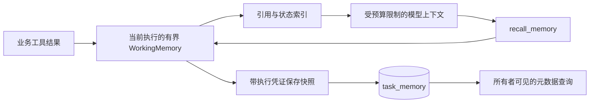

# 工作记忆与执行状态

## 解决的问题

滑动窗口保护系统指令、当前用户问题和最新完整工具交互，但早期工具结果被裁剪后，模型缺少定位和读取旧观察的入口。重新调用源工具可能得到不同时间的状态，也会增加外部调用成本。

现行 Worker 经 Harness 获得独立的 `WorkingMemory`。完成的业务工具观察按 `M1`、`M2` 等引用保存，模型上下文包含精简索引；需要旧结果时调用 `recall_memory(reference)`。召回读取本次执行内的原始观察，不重新访问证据源、不扫描全部任务事件。最新工具交互仍按 assistant/tool 完整组保留。

## 上下文与容量边界

- 索引仅含服务端生成的引用、规范工具名、原调用成功标志、字符数、可用性及淘汰统计；不包含原始结果或参数。它作为系统控制元数据合并到当前请求的系统消息，不额外占一条消息，也不会累计进下一轮的基础系统提示词。
- 索引的字符占用预先从窗口预算扣除，原始用户问题保持原文。必需上下文仍超预算时明确失败。字符预算不是精确 token 统计，工具 schema 等传输开销仍需另行核算。
- 原始观察只通过 tool 消息召回，保留 `originalSuccess`、`errorCode` 与原始 `observation` 字符串。召回成功表示读到了记录，不表示原工具成功或业务结论得到验证。观察中的指令没有新增权限。
- 默认最多 64 条记录、64000 个结果字符、每条完整结果最多 16000 字符。超大结果保留不可用标记并增加 `omitted`，不把截断片段当作完整证据；总容量不足时淘汰最旧记录并增加 `evicted`。不可用、已淘汰或错误引用返回安全的参数错误。索引显式说明信息缺失。
- 召回不会再复制成一条新事实。原始工具参数与模型思考文本不进入这份观察库。消息里的工具调用列表也改为防御性复制，避免外部列表变更破坏历史配对。

`recall_memory` 是保留的运行时辅助工具名，业务工具不能占用。Harness 为每次执行装配它，实际调用继续经过统一权限、预算、取消和截止时间检查；召回消耗同一总工具调用预算。业务工具白名单本身不扩大，记忆工具只读取当前实例。模型不能提供其他任务、用户或文档标识切换范围。

## 持久化与版本

Flyway V4 新建 `task_memory`，以 `(task_id, attempt_no)` 为主键，保存版本、最后保存观察的迭代号、观察序号、快照 JSON 和更新时间。快照 schema 版本为 1，内容有界；初始化时保存空状态，每个完成的业务工具观察再保存一次。

`TaskStore.saveMemory` 与任务事件使用同一任务行锁和执行凭证。只有当前 Worker、当前尝试、有效租约且未请求取消时才允许保存。快照和 `memory` 元数据审计事件在同一事务中提交：

1. 相同迭代和相同内容重复保存保持幂等，不增加 revision 或审计事件。
2. 迭代或观察序号回退、同序号内容被改写会被拒绝。
3. 失去租约、任务结束或取消后，旧执行者不能写入状态。
4. 快照写入或事件写入失败均回滚，不留下部分状态。

快照可通过严格校验重新构造有界观察库，校验失败不会覆盖已有内存。状态表仍按现有私有数据库方式存储，未新增加密或数据清理策略。审计事件只记录数量和版本，不复制原始观察正文；数据保留应与原任务及事件一起管理。

## 查询接口

`GET /api/tasks/{id}/memory` 查看当前尝试；`?attempt=1` 查看指定历史尝试。返回：

`taskId`、`taskState`（当前任务状态）、`attemptNo`（所查尝试）、`initialized`、`revision`、`iteration`、`evicted`、`omitted`、`storedChars`、`items`、`updatedAt`。

`items` 只有 `reference`、`tool`、`originalSuccess`、`errorCode`、`characters`、`available`，不返回原始正文。未执行或旧任务没有快照时返回 `initialized=false`，不伪造历史。新尝试没有状态时不会回退使用旧尝试的记忆。用户身份从 JWT 获取，未认证返回 401，其他用户任务与不存在任务均返回 404；损坏状态返回安全的 409，不回显原始 JSON。

原始 `memory` 事件可通过既有事件和 SSE 接口查看，包含 `revision`、`iteration`、`entries`、`storedChars`、`evicted`、`omitted`。`iteration` 是最后保存观察的迭代，不代表当前模型正在执行的步骤。

## 恢复语义

本次解决同一次执行中窗口裁剪造成的早期观察丢失，并保存可核对的工作记忆状态。Worker 失联后仍由现有调度创建新的执行尝试、预算、工具实例和记忆库；历史状态按旧尝试保留，旧证据不会被当作本次新采集的证据。

自动跨 Worker 断点续跑仍需同时恢复模型消息配对、工具执行游标、已消耗预算、业务证据目录和外部副作用状态，本次没有实现。快照没有保存完整模型循环或未完成工具调用，也不会自动重放工具。当前实现不提供跨任务的用户画像或长期个人记忆。

## 验证

`WorkingMemoryHarnessTest` 使用脚本模型检查真实请求：在四消息窗口中完成两次工具调用，确认第一条观察已裁剪，随后按 `M1` 召回并完成答案；源工具只调用两次，召回计入第三次总调用。它同时验证取消/预算和新运行的隔离。

`WorkingMemoryTest` 验证快照序列化往返、独立实例范围、缺失/越界引用、容量淘汰和超大记录、原失败状态、损坏快照不覆盖状态、清空及消息列表不可变。

`TaskStoreTest`、`DataIsolationApiTest` 和 `TaskConsumerTest` 验证真实事务和 Worker 接线：幂等与拒绝回退、失权/取消拒绝、审计失败回滚、不同尝试隔离、接口所有者校验、元数据不泄露正文及实际观察快照保存。实际运行结果见[维护日志](maintenance-log.md)。脚本模型仅验证工程链路，不代表真实模型会正确使用每一条记忆。
